<div align="center">

<picture>
  <source media="(prefers-color-scheme: dark)" srcset=".github/assets/banner-dark.svg">
  
</picture>

**Adaptive streaming and native playback for serious media apps.**<br>
Play HLS on iOS, HLS/DASH on Android, subtitles, tracks and DRM-protected sources while decode and rendering stay native.

[](https://packagist.org/packages/pushinbr/pam-native-video)
[](https://github.com/push-in/pam-native-video/releases/latest)

[](https://github.com/push-in/pam-native-video/actions/workflows/ci.yml)
[](LICENSE)

[Install](#install) · [Quick example](#quick-example) · [Platforms](#platform-support) · [DRM](#protected-playback) · [API](docs/api-reference.md) · [Issues](https://github.com/push-in/pam-native-video/issues)

</div>

<a id="install"></a>
## <picture></picture> Install

Inside a PAM Native project, add only this capability:

```sh
pam composer require pushinbr/pam-native-video
pam doctor --fix
```

New to PAM? Create a project with `pam init my-app --template native` (see the [PAM Native overview](https://push-in.github.io/pam-docs/native/overview/)), then come back here. See [what installation does](#requirements).

<a id="quick-example"></a>
## <picture></picture> Quick example

```php
use Pam\Native\Video\VideoEventKind;
use Pam\Native\Video\VideoPlayer;
use Pam\Native\Video\VideoResizeMode;

return VideoPlayer::make('https://cdn.example.com/master.m3u8')
    ->autoPlay()
    ->controls()
    ->resizeMode(VideoResizeMode::Cover)
    ->onEvent(function (VideoEventKind $kind, array $event): void {
        // Progress: $event['positionMillis'], ['durationMillis'], ['bufferedMillis'].
    });
```

Decoder, buffering, controls and progress timing remain native rather than crossing the PHP bridge per frame. This package is a horizontal playback primitive: it does not install a feed, social network or streaming application template. A runnable app lives in [`example/`](example/).

<a id="platform-support"></a>
## <picture></picture> Platform support

| Platform | Support | Notes |
| --- | --- | --- |
| Android | API 26+ | Media3 1.9.3 (ExoPlayer, DASH, HLS, UI); HLS, DASH, Widevine, ClearKey |
| iOS | 15.0+ | AVFoundation, AVKit; HLS, FairPlay |
| PAM Native | 0.8.0 to < 2.0.0 | From `pam-native.plugin.json`; PHP 8.5+ |

<a id="requirements"></a>
## <picture></picture> What installation does

`pam composer require pushinbr/pam-native-video` installs the package through the project's normal `composer.json` and `composer.lock`. Run `pam doctor --fix` afterward to validate the environment and regenerate native integration when required. The package is a PAM Native plugin with one native view (`video.player`); nothing is added to `pam-native.json`.

Use `pam packages` to inspect direct installed Composer dependencies and `pam composer remove pushinbr/pam-native-video` to uninstall the capability.

- **Android:** no permissions besides network access. Dependencies: `androidx.media3:media3-exoplayer`, `-exoplayer-dash`, `-exoplayer-hls` and `-ui` `1.9.3`. When `pam-native-media`, `pam-native-audio` or `pam-native-media-editor` (Media3 `1.10.1`) are installed too, Gradle resolves every Media3 artifact to the newest requested version.
- **iOS:** frameworks `AVFoundation` and `AVKit`; no Info.plist keys. FairPlay needs a certificate and license server of your own.

<a id="what-you-can-build"></a>
## <picture></picture> What you can build

- Streaming and IPTV applications
- Social and editorial video
- Offline-aware playback with native controls and subtitles

| | |
| --- | --- |
| **Native path** | Android Media3 · AVPlayer |
| **Application model** | Composer package + generated native integration |
| **Design rule** | Independent module; no feed, vertical or application template bundled |

<a id="protected-playback"></a>
## <picture></picture> Protected playback

Protected playback supports Widevine and ClearKey on Android and FairPlay on iOS. An incompatible DRM scheme produces a native playback error instead of silently playing without DRM. License exchange runs inside the native player; credentials should be short-lived.

```php
use Pam\Native\Video\VideoDrmConfiguration;
use Pam\Native\Video\VideoDrmScheme;
use Pam\Native\Video\VideoPlayer;

return VideoPlayer::make('https://cdn.example.com/movie/master.m3u8')
    ->drm(new VideoDrmConfiguration(
        scheme: VideoDrmScheme::FairPlay,
        licenseUrl: 'https://license.example.com/fps',
        authorization: 'Bearer '.$shortLivedToken,
        contentId: 'movie-42',
        certificateUrl: 'https://license.example.com/fairplay.cer',
    ))
    ->subtitle('https://cdn.example.com/subtitles/pt-BR.vtt')
    ->preferredForwardBuffer(15_000)
    ->autoPlay();
```

<a id="features"></a>
## <picture></picture> Features

Adaptive HLS playback, embedded subtitle/audio tracks, native controls, autoplay, looping, mute/volume, deterministic seek commands, configurable progress events and sandboxed local files. Android also supports DASH. External WebVTT, SRT and TTML subtitles are supported on both platforms; iOS loads at most 2 MiB and displays them in the AVKit content overlay. Embedded subtitles retain the platform's native track selection.

Every `VideoPlayer` method, event payload, DRM rule and error: [docs/api-reference.md](docs/api-reference.md).

On macOS, run the focused subtitle, time and sandbox checks with `swiftc ios/Sources/ExternalSubtitles.swift ios/Sources/VideoSafety.swift tests/ios-subtitles/main.swift -o /tmp/pam-video-ios-check && /tmp/pam-video-ios-check`.

<a id="when-to-use-it"></a>
## <picture></picture> When to use it

The PAM Native core already ships `<MediaPlayer>` (`Pam\Native\UI\MediaPlayer`) for feed, story and chat media; Zé Chat plays its gallery, story and editor videos with it. Add this package when you need what the core player does not do: DRM (Widevine, ClearKey, FairPlay), DASH on Android, external WebVTT/SRT/TTML subtitles, bitrate caps, forward-buffer tuning and native transport controls.

<a id="production-checklist"></a>
## <picture></picture> Production checklist

- Prefer adaptive HLS for both platforms; use DASH only for Android.
- Keep progress intervals coarse enough for the product experience.
- Pause or release playback when the owning screen loses visibility.
- Run `pam doctor`, `pam test`, and a signed release build on every supported platform.
- Exercise denial, cancellation, backgrounding, process restart and offline behavior before release.

<a id="troubleshooting"></a>
## <picture></picture> Troubleshooting

- **Remote playback fails:** verify HTTPS, codec, manifest and segment accessibility.
- **Seek appears ignored:** issue it as an intentional state revision, not every render.
- **Subtitles are absent:** inspect the embedded track, or check the external subtitle URL, format and 2 MiB iOS size limit.
- **Native integration is stale:** run `pam doctor --fix`, rebuild the native host, and inspect the first reported diagnostic.

<a id="compatibility"></a>
## <picture></picture> Compatibility

| `pushinbr/pam-native-video` | `pushinbr/pam-native` | Android | iOS |
| --- | --- | --- | --- |
| 0.4.x | `>=0.8.0 <2.0.0` (tested with 1.14.x) | API 26+, Media3 1.9.3 | 15+, external subtitles |
| 0.3.x | `>=0.8.0 <1.0.0` | API 26+ | 15+, no external subtitles |

Platform SDKs, credentials, entitlements, physical hardware and store configuration remain application responsibilities. Report security vulnerabilities through the repository security policy or GitHub private vulnerability reporting, not a public issue.

<a id="docs"></a>
## <picture></picture> Docs

- [API reference](docs/api-reference.md)
- [Example app](example/)
- [PAM Native overview](https://push-in.github.io/pam-docs/native/overview/)
- [Plugin and native capability model](https://push-in.github.io/pam-docs/native/plugins/)
- [PAM documentation](https://push-in.github.io/pam-docs/introduction/)
- [Changelog](CHANGELOG.md)
- [Report an issue](https://github.com/push-in/pam-native-video/issues)

<a id="pam-ecosystem"></a>
## <picture></picture> Part of the PAM ecosystem

<p align="center"><picture>
  <source media="(prefers-color-scheme: dark)" srcset=".github/assets/pam-wordmark-dark.svg">
  
</picture></p>

PAM runs PHP natively on servers, desktops and phones. This repository is one piece of it.

| [**PAM**](https://github.com/push-in/pam) | [**PAM Desktop**](https://github.com/push-in/pam-desktop) | [**PAM Native**](https://github.com/push-in/pam-native) | [**Ecosystem**](https://github.com/push-in/pam#ecosystem) |
| --- | --- | --- | --- |
| the runtime and CLI | native desktop apps in PHP | native Android and iOS apps in PHP | every official package and plugin |

<sub>Docs: [push-in.github.io/pam-docs](https://push-in.github.io/pam-docs/introduction/) · [Issues](https://github.com/push-in/pam-native-video/issues)</sub>

<p align="center"><sub><a href="LICENSE">Apache License 2.0</a> · Made in Brazil by Pushin</sub></p>
